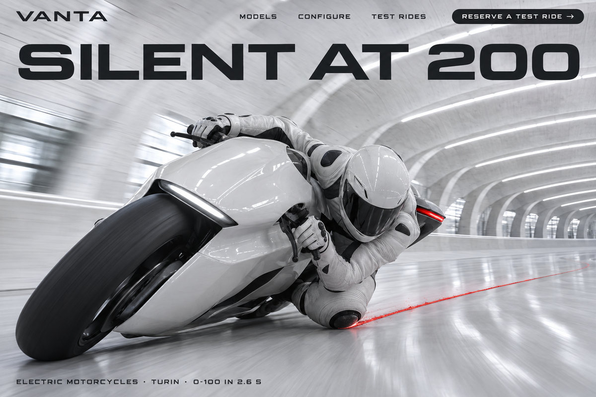
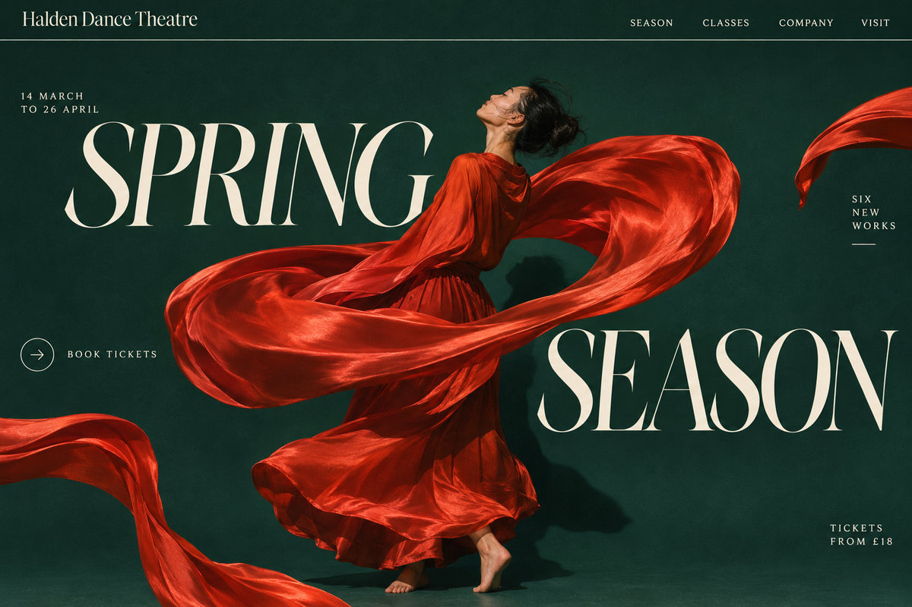
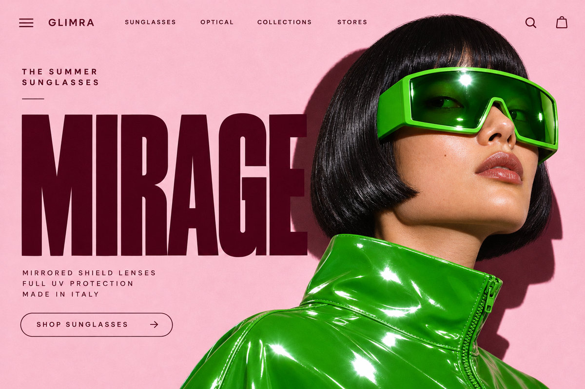
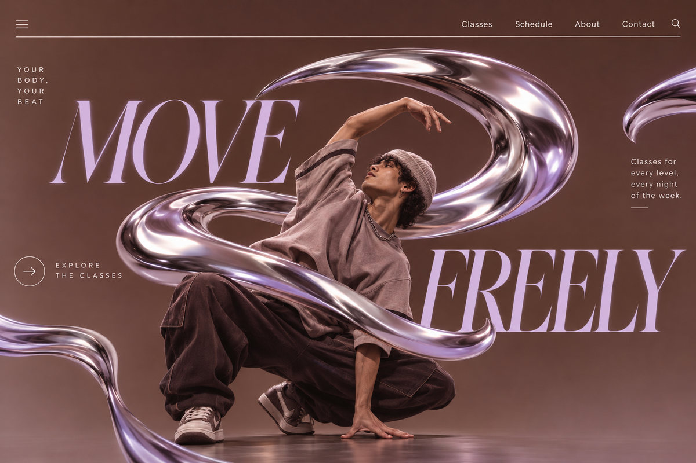
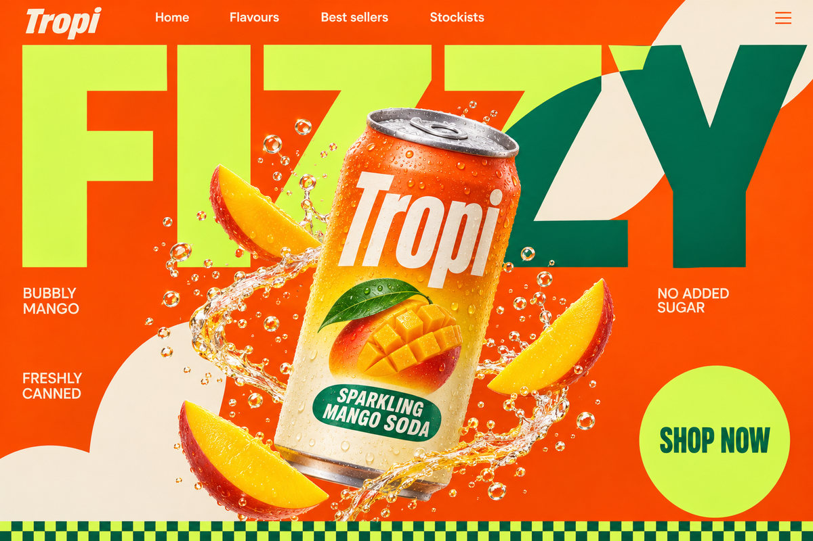
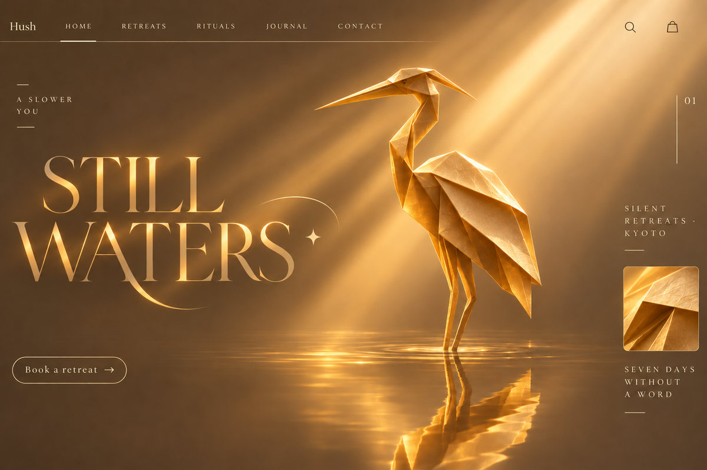

# charles-accent-heroes

Makes award-level landing-page hero images with one bold accent colour, as close variations of reference screenshots.

<p align="center">






</p>

## Install

Run this in your project:

```bash
npx skills add LemonFace0309/charles-skills --skill charles-accent-heroes
```

Add `-g` to install it for every project. It needs Python 3 and an OpenAI API key (`OPENAI_API_KEY`). The check that reads every word back only runs on macOS. Then start a new session and ask for it:

```text
/charles-accent-heroes four heroes for a ceramics studio, from my reference folder
```

Codex uses `$charles-accent-heroes` instead of the slash. To install by hand, and to see my other skills, read the [main README](../../README.md).
